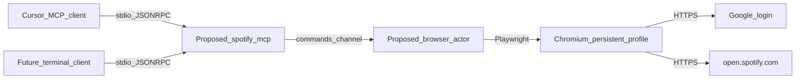
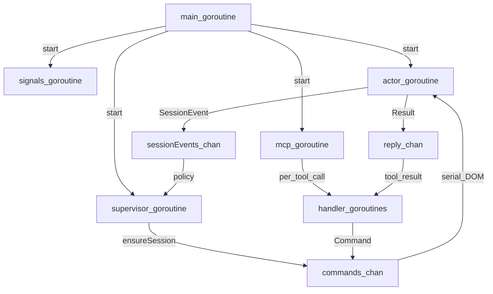
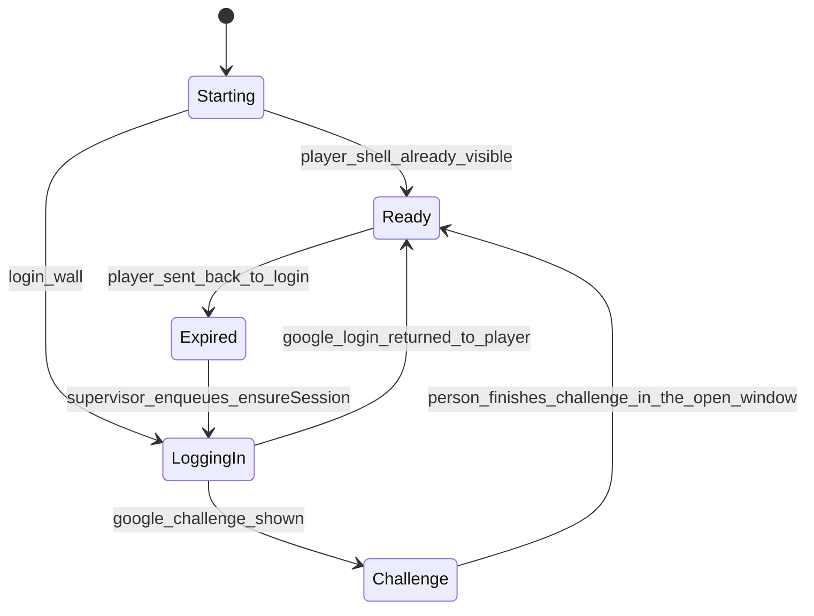

# Spotify MCP server

This document is the build guide for a local MCP server that drives the Spotify web player. The server process is Go. Playwright owns one Chromium window. The Google account comes from an env file. The Chromium profile on disk is the persisted login. Cursor is the client now. A later Linux terminal MCP host uses the same process over stdin and stdout.

The repo today is a stub. Implementation of the server comes after this guide. This file contains the architecture only.

## Scope

**Why**

- The server has one job: let an MCP client control the signed-in Spotify web player.
- A written boundary keeps later work from pulling in a second protocol, a second browser, or a custom UI.

**What**

- In scope: process shape, packages, files, boot order, Google login, profile persistence, tool contracts, goroutines, channels, the client swap, and failure behavior.
- Out of scope: the official Spotify Web API, playlist creation, more than one account, a custom terminal UI, background lyric polling, captcha solving, and any bypass of a Google challenge.

**How**

- Build only the packages and files in the folder map.
- Leave Cursor as a replaceable host. The server binary has no Cursor import.
- When a Google challenge appears, stop automation and leave the window open for the person at the machine.

## Evidence and unknowns

**Why**

- The guide has to match the folders that already exist, and it has to say what is still unknown so implementation does not invent selectors or library versions.

**What**

- Verified in this workspace:
  - [mcp/go.mod](mcp/go.mod) is module `shanks` on Go `1.22.2`.
  - [mcp/cmd/spotify/main.go](mcp/cmd/spotify/main.go) is a stub. `run` returns a value from a function that has no result, so the package does not compile yet.
  - [mcp/internal/spotify/spotify.go](mcp/internal/spotify/spotify.go) is empty.
  - [mcp/internal/tools](mcp/internal/tools) exists and is empty.
  - There is no env file, no MCP dependency, and no Playwright dependency yet.
- User-stated requirements: a custom MCP server; Playwright logs into Spotify through Google using an account from an env file; login persists; the premium web player then opens; tools search, change songs, and add songs to playlists from the model's prompt; a separate tool scrapes lyrics from the Playwright DOM; goroutines and channels carry the concurrency; Cursor is the client for now; a Linux terminal client comes later.
- Unknown until implementation: the live Spotify DOM, whether Go `1.22.2` is new enough for the MCP library and the Playwright Go binding, and whether this Google account will show a challenge.

**How**

- Keep the existing roots `mcp/cmd/spotify`, `mcp/internal/spotify`, and `mcp/internal/tools`.
- Treat library choice as proposed. At implementation time, check the MCP stdio library and the Playwright Go binding against Go `1.22.2`. Bump the `go` line only when a library actually requires it.
- Fill selector names by inspecting a logged-in player page during implementation. This guide does not invent them.
- Specify challenge behavior now, so an unknown 2FA prompt still has a defined phase.

## Decisions

**Why**

- These choices fix the shape of every file, goroutine, and tool. Later sections assume them.

**What**

- The client interprets the person's prompt. The server exposes seven tools. The model maps "play X", "next", "add this to a playlist", and "lyrics" onto those tools. There is no free-form prompt tool inside the server, because that would duplicate the client.
- One Chromium page is shared by playback, search, playlists, and lyrics. Playwright calls on that page are serial. Concurrency is the queue in front of the page.
- Persistence is the Chromium user-data directory. Cookies and Google device state stay inside Chromium. The app does not keep its own cookie jar.
- Login runs at boot. The supervisor enqueues session setup. The model can read the phase through `spotify_session`: `starting`, `ready`, `challenge`, or `expired`.
- A Google 2FA prompt, a captcha, or a "browser not secure" wall emits `challenge` and leaves the window open. The server does not loop the password and does not try to defeat the challenge.
- Stdout is reserved for MCP JSON-RPC. Logs go to stderr. A normal print on stdout breaks Cursor and any later terminal client.
- Email and password live only in `mcp/.env` or in the environment the client injects. They stay out of Go source, logs, and tool results.
- A search handle is the visible title, the artist, the result index, and a track id only when the page href actually contains one. A handle is stale after the next search navigation. Playback confirmation is the now-playing bar after the click.
- Playlist add matches a playlist name already visible on the account. An unknown name returns the names visible in the add-to-playlist UI. Creating a playlist is out of scope.
- Lyrics apply to the current track only. The lyrics tool does not start playback.
- Proposed libraries, not yet in the repo: a Go MCP library that serves stdio JSON-RPC, and Playwright's Go binding.

**How**

- Encode each decision in the package that owns it: config for secrets, runtime for the queue and the session machine, browser for Playwright ownership, spotify for DOM flows, tools for MCP arguments.
- Reject a design that adds a second page owner, a prompt-parsing tool, or a hand-rolled cookie file.

## System context

**Why**

- Cursor and a later terminal client must be replaceable without a server rewrite.
- Spotify and Google stay outside the process. Playwright is the only browser driver.

**What**

- One long-lived OS process from `mcp/cmd/spotify`.
- Transport is MCP over stdin and stdout.
- Chromium is a child process with a persistent profile.
- External sites are Google accounts and `https://open.spotify.com`.

**How**

- The client spawns the process and speaks MCP. The server never imports Cursor.
- The same binary is what a later terminal MCP host spawns.



## Dependency direction

**Why**

- One-way imports keep tool handlers from touching the page, and keep page helpers from knowing about MCP.

**What**

- `tools` may enqueue a command. `tools` must not import `browser`.
- `browser` is the only caller of `spotify` page actions. `spotify` must not import `tools` or `runtime`.
- `runtime` owns channel types and the supervisor. `runtime` must not import Playwright.
- `mcp` owns the stdio loop. `mcp` must not import `browser`.

**How**

- `main` is the only place that knows every package. It constructs the bus and passes it into the actor, the supervisor, and the tool handlers.

## Folder and file map

**Why**

- The current roots stay: [mcp/cmd/spotify](mcp/cmd/spotify), [mcp/internal/spotify](mcp/internal/spotify), and [mcp/internal/tools](mcp/internal/tools).
- New packages exist only where the responsibility would otherwise land in `main`.

**What**

- Each file below has one job. Proposed files are created at implementation time. This guide does not create them.

**How**

- Follow the why, what, and how on each file when that file is written.

### [README.md](README.md)

- **Why:** one place for this design.
- **What:** this document.
- **How:** it lives at the repo root, above `mcp/`.

### [mcp/go.mod](mcp/go.mod)

- **Why:** the process is already module `shanks`.
- **What:** module path and Go version. `go.sum` appears only when implementation fetches modules.
- **How:** stay on `1.22.2` unless a verified library requirement forces a bump.

### [mcp/cmd/spotify/main.go](mcp/cmd/spotify/main.go)

- **Why:** one wiring point. DOM logic and tool policy live in other packages.
- **What:** load config, build the bus, start the goroutines, and wait until the actor has closed Chromium. The file exists today as a non-compiling stub.
- **How:** at implementation time, replace the stub. `main` starts `signals`, `actor`, `supervisor`, and `mcp`, then blocks on `actorStopped`. This guide does not edit the stub.

### [mcp/internal/config/config.go](mcp/internal/config/config.go)

- **Why:** email, password, profile path, and the headless flag are read once and passed down. Tools do not re-read the environment.
- **What:** the env contract.
  - `SPOTIFY_GOOGLE_EMAIL`
  - `SPOTIFY_GOOGLE_PASSWORD`
  - `SPOTIFY_PROFILE_DIR`, default `mcp/data/chrome-profile`
  - `SPOTIFY_HEADLESS`, default false
- **How:** if `mcp/.env` exists, load it. A real environment variable wins over the file, so Cursor's MCP env and a terminal `.env` share one binary.

### [mcp/.env.example](mcp/.env.example)

- **Why:** show the variable names with empty secrets.
- **What:** empty values, plus a note that the profile directory is secret. Created when implementing, not by this guide.
- **How:** the real `mcp/.env` is gitignored and never committed.

### [mcp/internal/runtime/command.go](mcp/internal/runtime/command.go)

- **Why:** tools, the supervisor, and the actor need one job shape.
- **What:** command kind, arguments, a per-call reply channel, and the request context.
- **How:** kinds match the seven tools plus `ensureSession`. This file has no Playwright types.

### [mcp/internal/runtime/bus.go](mcp/internal/runtime/bus.go)

- **Why:** channel construction stays out of `main`, so buffer sizes have one owner.
- **What:** the channel bundle in the channels section.
- **How:** `main` calls one constructor and passes the bundle into the actor, the supervisor, and the tools.

### [mcp/internal/runtime/supervisor.go](mcp/internal/runtime/supervisor.go)

- **Why:** login policy is neither a tool nor a click helper.
- **What:** the session state machine.
- **How:** it only sends on `commands` and receives on `sessionEvents`. It never holds a Playwright page.

### [mcp/internal/runtime/signals.go](mcp/internal/runtime/signals.go)

- **Why:** a killed terminal must not orphan Chromium.
- **What:** watch for SIGINT and SIGTERM.
- **How:** cancel the root context. The actor finishes the current command, then closes the browser.

### [mcp/internal/browser/launch.go](mcp/internal/browser/launch.go)

- **Why:** profile path, headed versus headless, and process start are separate from clicks.
- **What:** start Chromium with the persistent profile directory.
- **How:** the actor calls this once per browser lifetime. A crash event is the only reason to launch again.

### [mcp/internal/browser/actor.go](mcp/internal/browser/actor.go)

- **Why:** exactly one goroutine may touch the page.
- **What:** the command loop.
- **How:** read `commands`, run one kind to completion, send the result on that command's reply channel, and publish a session event when the login phase changes.

### [mcp/internal/browser/google_login.go](mcp/internal/browser/google_login.go)

- **Why:** Google form steps stay out of the Spotify page helpers.
- **What:** the `ensureSession` procedure.
- **How:** open the web player. If the player shell is already there, publish `loggedIn` and stop. Otherwise use the Google button and the env account. On a challenge, publish `challenge` and stop. Chromium persists the resulting session because the user-data directory is reused. The app does not write the password into the profile itself.

### [mcp/internal/spotify/open.go](mcp/internal/spotify/open.go)

- **Why:** opening the premium account is a navigation check, not a tool.
- **What:** go to the web player and detect the logged-in shell versus a login wall.
- **How:** `ensureSession` calls it after launch and after Google returns.

### [mcp/internal/spotify/search.go](mcp/internal/spotify/search.go)

- **Why:** search is its own DOM flow.
- **What:** focus search, enter the query, scrape result rows into handles.
- **How:** the actor calls it for `spotify_search`.

### [mcp/internal/spotify/transport.go](mcp/internal/spotify/transport.go)

- **Why:** play, pause, resume, next, and previous share the player bar.
- **What:** click the control, then read the now-playing bar as confirmation.
- **How:** used by `spotify_play` and `spotify_control`.

### [mcp/internal/spotify/playlist.go](mcp/internal/spotify/playlist.go)

- **Why:** the add-to-playlist menu is a different widget from the player bar.
- **What:** open the track menu, choose the named playlist, report success or the visible names.
- **How:** used only by `spotify_add_to_playlist`.

### [mcp/internal/spotify/lyrics.go](mcp/internal/spotify/lyrics.go)

- **Why:** lyrics are a panel scrape, not player metadata.
- **What:** open the lyrics view for the current track, read the lines, and leave the player so later transport clicks still hit the bar.
- **How:** used only by `spotify_lyrics`. If the lyrics control is absent, return unavailable. The scrape stays on the Spotify page.

### [mcp/internal/spotify/selectors.go](mcp/internal/spotify/selectors.go)

- **Why:** the web player DOM will change. One file is the only place that knows how to find search, transport, playlist, and lyrics nodes.
- **What:** the lookup names used by the other spotify files.
- **How:** fill them during implementation by inspecting a logged-in page. Remove the empty [mcp/internal/spotify/spotify.go](mcp/internal/spotify/spotify.go) at that time so this package stays a set of focused files.

### [mcp/internal/mcp/serve.go](mcp/internal/mcp/serve.go)

- **Why:** stdin and stdout framing, and the stderr-only log rule, are protocol concerns. [mcp/internal/tools](mcp/internal/tools) already exists for tools, so the protocol gets its own package.
- **What:** build the stdio MCP server, register tools, and run until the root context is cancelled.
- **How:** `main` starts it as the `mcp` goroutine. This package does not import `browser`.

### [mcp/internal/tools/register.go](mcp/internal/tools/register.go)

- **Why:** the client needs one list of tools it can discover.
- **What:** names, descriptions, and argument fields for the seven tools.
- **How:** each tool file supplies its handler. Descriptions are written so a model can route ordinary playback sentences. There is no prompt tool.

### Per-tool files under [mcp/internal/tools](mcp/internal/tools)

- **Why:** one file is one tool's argument checks and the command it enqueues.
- **What:** `session.go`, `search.go`, `play.go`, `control.go`, `now_playing.go`, `playlist.go`, `lyrics.go`.
- **How:** validate args, send on `commands`, and wait on that call's reply. If the client cancels, return an error to the client. The actor still finishes the in-flight click, because a half-finished Playwright action is not safe to abort. The reply send also watches the command context, so a handler that has already returned cannot deadlock the actor.

### [mcp/data/chrome-profile](mcp/data/chrome-profile)

- **Why:** this directory is the persisted login.
- **What:** the Chromium user-data directory. It is created on first launch and gitignored when implementation starts.
- **How:** treat it like a password. Point `SPOTIFY_PROFILE_DIR` at it, or leave the default.

## Goroutines

**Why**

- The MCP read loop has to stay alive while a click is running.
- Several tool calls have to enter a queue together.
- Login policy has to sit beside the browser, and shutdown has to join the browser process.
- The page itself stays serial. A second loop on the same page would interleave keystrokes and menus.

**What**

- Six roles: `main`, `signals`, `mcp`, `handler`, `actor`, `supervisor`.
- `handler` is short-lived, one per in-flight tool call.
- There is no lyrics goroutine and no background poller. Lyrics is a command kind on `commands`, fetched when the tool is called.

**How**

- `main` starts the long-lived goroutines and passes them the bus.
- Handlers and the supervisor send commands. The actor is the only consumer.
- The actor publishes session events. The supervisor is the only consumer of those events.



### `main`

- **Why:** the process exits when `main` returns, so this goroutine is the lifetime anchor.
- **What:** wire config and the bus, start the other long-lived goroutines, and block until shutdown has closed Chromium.
- **How:** after the root context is cancelled, wait on `actorStopped`. Keep tool logic out of this goroutine.

### `signals`

- **Why:** Ctrl-C in Cursor's host or in a terminal must reach the actor.
- **What:** a goroutine blocked on the OS signal channel.
- **How:** on SIGINT or SIGTERM, cancel the root context.

### `mcp`

- **Why:** the client speaks a stream of JSON-RPC messages. That read loop must stay alive while a song click is running.
- **What:** the stdio server loop.
- **How:** decode a tool call and hand it to a handler. This goroutine never calls Playwright. Logs from this loop go to stderr.

### `handler`

- **Why:** two overlapping client calls must both enter the queue. The second call waits in the queue while lyrics or search is still running.
- **What:** a short goroutine, usually created by the MCP library for that request.
- **How:** validate, send one `Command`, then wait on that command's `reply` or the request context. Return the tool result to the MCP loop.

### `actor`

- **Why:** one page cannot run search and lyrics clicks at the same time.
- **What:** the only goroutine that uses Playwright.
- **How:** loop on `commands` until the channel is closed. Run the command fully. Send one result. Publish a session event when the login phase changes. On shutdown, close Chromium, then close `actorStopped`.

### `supervisor`

- **Why:** the model is not responsible for Google login, and the actor does not invent retry policy.
- **What:** the session state machine.
- **How:** at start, enqueue `ensureSession`. On `expired` or `browserCrashed`, enqueue it again. On `challenge`, stop enqueueing and keep the last phase so `spotify_session` can report it. This goroutine never touches the page.

### Lyrics and polling

- **Why:** a second loop on the same page would race the actor. MCP is request and response, so lyrics are fetched when the tool is called.
- **What:** lyrics is a command kind, the same as play and search.
- **How:** the lyrics handler enqueues on `commands` and waits for its own reply.

## Channels

**Why**

- Channels are the handoff between concurrent goroutines and the single page owner.
- A private reply channel pairs each tool call with its own result.
- Separate feature channels would still need one page owner, which brings back a lock or a race. One `commands` queue, distinguished by command kind, is the whole DOM schedule.

**What**

- `commands`, per-call `reply`, `sessionEvents`, `ready`, the root context `Done` channel, and `actorStopped`.
- The actor switches on command kind and calls the matching file under `internal/spotify` or `internal/browser`.

**How**

- Producers and consumers are fixed. Buffer sizes live in the bus constructor.

### `commands` (buffered, capacity 8)

- **Why:** this is the handoff that lets handlers submit work while the browser is busy. Capacity 8 is backpressure. A 9th sender waits, so a burst cannot grow memory without bound.
- **What:** `Command` values.
- **How:** producers are handlers and the supervisor. The only consumer is the actor. Close it only during shutdown, after the supervisor has stopped sending.

### `reply` (one channel per command, capacity 1)

- **Why:** each call needs a private mailbox. A shared result channel would hand a search result to a lyrics caller.
- **What:** a single `Result`, either an ok payload or a typed error.
- **How:** the handler creates it. The actor sends exactly once. If the handler already returned because the client cancelled, the actor selects on the reply send and the command context, then drops the result. The page work has still finished, so the next command sees a consistent player.

### `sessionEvents` (buffered, capacity 4)

- **Why:** the actor must publish login facts without running policy, and without blocking the next command when the supervisor is busy.
- **What:** `needsLogin`, `loggedIn`, `challenge`, `expired`, `browserCrashed`. The `ready` channel is a different signal.
- **How:** only the actor sends. Only the supervisor receives.

### `ready` (closed once)

- **Why:** many waiters need to hear that login succeeded. Closing a channel broadcasts that fact once.
- **What:** a one-shot gate. The channel carries no payload.
- **How:** the supervisor closes it when it first sees `loggedIn`. The MCP loop does not wait on it, so the client can connect and call `spotify_session` during login. Song tools that arrive early wait a bounded time on `ready`, or return `session_not_ready`. They do not click the login page.

### Root context `Done`

- **Why:** one cancel reaches the MCP loop, the supervisor, and the actor's shutdown path.
- **What:** the shutdown signal.
- **How:** `signals` cancels the root context. The actor finishes the current command, leaves the loop, and then closes the browser.

### `actorStopped` (closed once)

- **Why:** `main` must stay alive until Chromium is gone.
- **What:** a join signal.
- **How:** the actor closes it after Playwright shutdown. `main` waits on it.

## Session lifecycle

**Why**

- The first launch has to sign in with Google. Later launches reuse the profile and only open Spotify.
- A dead session has to heal without a new tool.

**What**

- Phases are `Starting`, `LoggingIn`, `Challenge`, `Ready`, and `Expired`.
- `Ready` means the web player shell is visible for the account stored in the profile.
- Premium is the subscription already attached to that Google account. The server does not send payment or plan-change clicks.

**How**

- Headed is the default so a challenge is visible.
- `SPOTIFY_HEADLESS=true` is allowed after a profile has reached `Ready` once.
- Headless plus a new challenge publishes `challenge`. The status tool tells the person to rerun headed.
- A bad password returns one error on the session path and does not retry in a loop.
- Boot order: `main` builds the bus, the actor launches Chromium, the supervisor enqueues `ensureSession`, and the MCP loop starts without waiting for `ready`.



### `ensureSession`

- **Why:** login is process boot, so the model can ask for songs after the player exists.
- **What:** one command kind on `commands`, implemented by the Google login file plus the Spotify open file.
- **How:** open `https://open.spotify.com`. If the player shell is visible, publish `loggedIn`. If a login wall is visible, click continue with Google, fill the env account, and wait for the player shell. If Google shows a challenge, publish `challenge` and leave the window open.

## Tool calls

**Why**

- The model needs a small set of actions that match play, change, search, playlist add, and lyrics.
- Each action is a request the client can call by name. The server queues the matching DOM flow.

**What**

- Seven tools: `spotify_session`, `spotify_search`, `spotify_play`, `spotify_control`, `spotify_now_playing`, `spotify_add_to_playlist`, `spotify_lyrics`.
- Browser work happens only inside the actor.

**How**

- Every handler checks args, enqueues one command, waits for `reply`, and returns text the model can read.

```mermaid
sequenceDiagram
  participant Client
  participant Mcp as mcp_goroutine
  participant Handler
  participant Commands as commands_chan
  participant Actor as actor_goroutine
  participant Page as Playwright_page

  Client->>Mcp: tools/call
  Mcp->>Handler: start_handler
  Handler->>Commands: Command_plus_reply
  Commands->>Actor: next_command
  Actor->>Page: one_DOM_flow
  Page-->>Actor: scraped_text
  Actor-->>Handler: reply_Result
  Handler-->>Mcp: tool_result
  Mcp-->>Client: JSONRPC_result
```

### `spotify_session`

- **Why:** the model needs to know whether it can play, or whether a person must finish a Google challenge.
- **What:** the phase, and a redacted account hint. The password is never included.
- **How:** a short command so the answer is ordered behind any in-flight click. Handler file: `internal/tools/session.go`.

### `spotify_search`

- **Why:** play and playlist-add need a handle taken from the page.
- **What:** args `query` and `limit`. The result is an ordered list of handles. Playback stays unchanged.
- **How:** the actor runs `internal/spotify/search.go`. Handler file: `internal/tools/search.go`.

### `spotify_play`

- **Why:** this is the action that starts a song.
- **What:** args are either a handle from the latest search, or a `query` that means play the top hit.
- **How:** `internal/spotify/transport.go` clicks play, then scrapes the now-playing bar and returns that title. A mismatch between the requested track and the bar is an error result. Handler file: `internal/tools/play.go`.

### `spotify_control`

- **Why:** changing songs is next, previous, pause, and resume. Those actions are separate from a new search.
- **What:** arg `action` is one of `pause`, `resume`, `next`, `previous`.
- **How:** click that player-bar control, then return the now-playing bar so the model can see the track. Handler file: `internal/tools/control.go`. Page work lives in `internal/spotify/transport.go`.

### `spotify_now_playing`

- **Why:** lyrics and "add this" refer to the current track. The model can read it while playback stays as it is.
- **What:** title and artist from the player bar, or `nothing_playing`.
- **How:** a read-only scrape. Handler file: `internal/tools/now_playing.go`.

### `spotify_add_to_playlist`

- **Why:** "add this to a named playlist" is a write on the web player.
- **What:** arg `playlist_name`, plus either the current track or a search handle.
- **How:** `internal/spotify/playlist.go` drives the on-page menu. An unknown name returns the visible names and does not create a playlist. A stale handle returns an error that tells the model to search again. Handler file: `internal/tools/playlist.go`.

### `spotify_lyrics`

- **Why:** lyrics are a separate DOM scrape of the current track.
- **What:** no required args. The result is the current track plus lyric lines, or `lyrics_unavailable`.
- **How:** `internal/spotify/lyrics.go` opens the on-player lyrics panel and reads the text nodes. The scrape stays on Spotify. If nothing is playing, the result is `nothing_playing` and the tool does not search. Handler file: `internal/tools/lyrics.go`.

## Clients

**Why**

- The server should keep working after Cursor is no longer the host. The swap is the host, not a new protocol.

**What**

- Now: Cursor spawns this process from its MCP config. Env values come from that config or from `mcp/.env`.
- Later: any Linux MCP host that spawns the same binary and speaks stdio. This design has no `cmd/client`. A custom terminal UI would be a different project.

**How**

- Spawn contract:
  - Executable: the `mcp/cmd/spotify` process.
  - Transport: MCP JSON-RPC on stdin and stdout.
  - Env: `SPOTIFY_GOOGLE_EMAIL`, `SPOTIFY_GOOGLE_PASSWORD`, optional `SPOTIFY_PROFILE_DIR`, optional `SPOTIFY_HEADLESS`.
  - Logs: stderr only.
- Server packages stay free of Cursor-specific code. A project MCP config entry can exist later as client configuration. It is not part of the server packages.
- Pointing a terminal host at the binary is a client change. The channels, tools, and browser actor stay the same.

## Failure behavior

**Why**

- Login walls, DOM drift, crashes, and a full queue each need one outcome so the actor and the model stay aligned.

**What**

- Each case below is a defined result. The process keeps the single-owner rule in every case.

**How**

- Google challenge: stay on `Challenge`, leave the window open, and make song tools return `session_not_ready`.
- Bad password: one failure, then stop. The supervisor does not enqueue another password attempt.
- A missing Spotify control: that tool returns a typed error. The other tools stay registered.
- Browser crash: the actor publishes `browserCrashed`. After the actor has launched Chromium again, the supervisor enqueues `ensureSession`.
- Client disconnect: if the host kills the process, the root context cancels. The in-flight DOM action still finishes. Then Chromium closes and `main` sees `actorStopped`.
- Full `commands` buffer: the extra handler waits on send. That wait is the backpressure.

## Implementation order

**Why**

- The queue and the session have to exist before song tools, and Cursor should attach only after play actually works.

**What**

- The ordered list below. The Phases section is the same sequence with files, goroutines, and a finish line for each slice.

**How**

- Config and bus first, with no browser, so the goroutines and channels can be reviewed on their own.
- Actor, persistent profile, and `ensureSession`, headed, until the player shell shows.
- `spotify_session`, then search, play, control, and now playing.
- Playlist add.
- Lyrics scrape.
- Point Cursor at the binary only after session and play work.
- A terminal host is a different MCP client aimed at the same binary.

## Phases

**Why**

- The implementation order above is the sequence. These phases turn that sequence into build slices with a finish line for each slice.
- A later phase starts only after the previous phase's finish line is true. Song tools stay off the page until the session phase has reached the player shell.

**What**

- Nine phases. Each one names the files it creates, the goroutines and channels that become live, and the tools that start working.
- The dependency rules, channel capacities, tool contracts, and failure behavior earlier in this guide stay in force. A phase does not add a second page owner, a prompt tool, or a cookie jar.

**How**

- Finish the phase, check the finish line, then start the next one.
- Logs stay on stderr from the first process that speaks MCP.
- Selector names are written only while a logged-in player page is open, inside the phase that first needs them.

### Phase 1 — Layout, env, and libraries

- **Why:** the process needs a secret file, a gitignored profile path, and libraries that actually build on this module before any goroutine is worth wiring.
- **What:**
  - Confirm [mcp/go.mod](mcp/go.mod) stays module `shanks`.
  - Choose a Go MCP library that serves stdio JSON-RPC, and Playwright's Go binding. If either library requires a newer Go than `1.22.2`, bump the `go` line then.
  - Add [mcp/.env.example](mcp/.env.example) with empty `SPOTIFY_GOOGLE_EMAIL`, `SPOTIFY_GOOGLE_PASSWORD`, `SPOTIFY_PROFILE_DIR`, and `SPOTIFY_HEADLESS`.
  - Gitignore `mcp/.env` and `mcp/data/chrome-profile`.
  - Create a local `mcp/.env` by hand. Leave it uncommitted.
- **How:**
  - Fetch the two libraries and record the versions that compiled.
  - Leave [mcp/cmd/spotify/main.go](mcp/cmd/spotify/main.go) as wiring only. This phase still has no browser and no tools.
- **Finish line:** the module builds, `.env.example` lists the four variables, and the real env file and profile directory are ignored by git.
- **Still later:** channels, Chromium, and every tool.

### Phase 2 — Config, bus, and process lifetime

- **Why:** the queue and the shutdown join have to be real before Playwright exists, so a browser bug is not confused with a channel bug.
- **What:**
  - Create [mcp/internal/config/config.go](mcp/internal/config/config.go), [mcp/internal/runtime/command.go](mcp/internal/runtime/command.go), [mcp/internal/runtime/bus.go](mcp/internal/runtime/bus.go), [mcp/internal/runtime/signals.go](mcp/internal/runtime/signals.go), and [mcp/internal/runtime/supervisor.go](mcp/internal/runtime/supervisor.go).
  - Replace the stub in [mcp/cmd/spotify/main.go](mcp/cmd/spotify/main.go) so it loads config, builds the bus, and starts goroutines.
  - Live goroutines: `main`, `signals`, `supervisor`, and a stand-in `actor` that owns `commands` and replies without opening a browser.
  - Live channels: `commands` (capacity 8), a capacity-1 `reply` per command, `sessionEvents` (capacity 4), `ready`, the root context `Done` channel, and `actorStopped`.
- **How:**
  - The stand-in actor reads one command at a time, sends one result, and on shutdown closes `actorStopped`.
  - The supervisor enqueues `ensureSession` at start and consumes `sessionEvents`. The stand-in answers that command with phase `starting`.
  - `signals` cancels the root context on SIGINT and SIGTERM. `main` returns only after `actorStopped`.
  - Keep Playwright out of `runtime`. Keep tool handlers out of this phase.
- **Finish line:** starting the process and stopping it with SIGINT closes the actor and returns. A burst of more than eight commands blocks the ninth sender. Cancelling a waiting handler does not leave the stand-in actor stuck on its reply send.
- **Still later:** Chromium, Google login, and MCP stdio.

### Phase 3 — Browser actor and Google session

- **Why:** playback depends on a persisted login. This phase is done when a second launch opens the player from the profile.
- **What:**
  - Create [mcp/internal/browser/launch.go](mcp/internal/browser/launch.go), [mcp/internal/browser/actor.go](mcp/internal/browser/actor.go), [mcp/internal/browser/google_login.go](mcp/internal/browser/google_login.go), and [mcp/internal/spotify/open.go](mcp/internal/spotify/open.go).
  - Replace the stand-in actor with the real actor. That goroutine is now the only Playwright user.
  - `ensureSession` becomes the real boot command. The supervisor still only sends on `commands` and reads `sessionEvents`.
  - The profile directory is `SPOTIFY_PROFILE_DIR`, default `mcp/data/chrome-profile`.
- **How:**
  - Launch Chromium headed. `SPOTIFY_HEADLESS` stays false.
  - Open `https://open.spotify.com`. If the player shell is already visible, publish `loggedIn` and close `ready`.
  - If a login wall is visible, continue with Google and fill the env account. On success, publish `loggedIn`.
  - On a 2FA prompt, a captcha, or a browser warning, publish `challenge`, leave the window open, and stop enqueueing login.
  - A bad password publishes one failure and does not loop.
  - On `browserCrashed`, launch Chromium again and let the supervisor enqueue `ensureSession` once.
  - Delete the empty [mcp/internal/spotify/spotify.go](mcp/internal/spotify/spotify.go) when the spotify package gains `open.go`, so the package is the focused files from the folder map.
- **Finish line:** the first headed run reaches the player shell, or stops on `challenge` with the window still open. After a successful run, a second start reaches the player shell from the profile without typing the Google password again. Song tools still do not exist.
- **Still later:** search, play, playlist, lyrics, and any client config.

### Phase 4 — MCP stdio and `spotify_session`

- **Why:** the status tool has to speak MCP before song tools exist, so stdout stays a clean JSON-RPC pipe while the session phase is the only browser command.
- **What:**
  - Create [mcp/internal/mcp/serve.go](mcp/internal/mcp/serve.go), [mcp/internal/tools/register.go](mcp/internal/tools/register.go), and [mcp/internal/tools/session.go](mcp/internal/tools/session.go).
  - Start the `mcp` goroutine from `main`. It registers one tool, `spotify_session`.
  - `mcp` does not import `browser`. The handler enqueues a session command and waits on that command's `reply`.
- **How:**
  - Bind the server to stdin and stdout. Send every log line to stderr.
  - `spotify_session` returns the phase and a redacted account hint. It never returns the password.
  - The MCP loop starts without waiting on `ready`, so a client can call `spotify_session` during `starting`, `challenge`, and `ready`.
  - Drive this with any stdio MCP caller. Cursor is still not configured.
- **Finish line:** a stdio client lists one tool and gets a phase back. A print of a log line never appears on stdout. While the phase is `challenge` or `starting`, the process stays up and the window stays open.
- **Still later:** search, play, control, now playing, playlist, lyrics, Cursor.

### Phase 5 — Search and playback

- **Why:** this is the first slice that changes what is playing. It waits until Phase 3 can reach `Ready` and Phase 4 can report that phase.
- **What:**
  - Create [mcp/internal/spotify/selectors.go](mcp/internal/spotify/selectors.go), [mcp/internal/spotify/search.go](mcp/internal/spotify/search.go), and [mcp/internal/spotify/transport.go](mcp/internal/spotify/transport.go).
  - Create [mcp/internal/tools/search.go](mcp/internal/tools/search.go), [mcp/internal/tools/play.go](mcp/internal/tools/play.go), [mcp/internal/tools/control.go](mcp/internal/tools/control.go), and [mcp/internal/tools/now_playing.go](mcp/internal/tools/now_playing.go).
  - Register `spotify_search`, `spotify_play`, `spotify_control`, and `spotify_now_playing`.
  - Fill selector names by inspecting the logged-in player. Search, the player bar, and the now-playing title live in `selectors.go` only.
- **How:**
  - Song tools that run before `ready` wait a bounded time, then return `session_not_ready`. They do not click the login page.
  - `spotify_search` returns handles (title, artist, result index, and a track id only when the href has one) and does not start playback.
  - `spotify_play` accepts a handle from the latest search, or a query that plays the top hit. The result is the now-playing bar. A mismatch is an error result.
  - `spotify_control` accepts `pause`, `resume`, `next`, and `previous`, then returns the bar.
  - `spotify_now_playing` only reads the bar. An empty bar returns `nothing_playing`.
  - All four handlers share `commands`. The actor runs one DOM flow at a time.
- **Finish line:** with the phase `ready`, search returns rows, play starts the chosen row, next changes the bar, pause stops the audio, and now-playing matches the bar. A second search makes the previous handle return a stale-handle error.
- **Still later:** playlist add, lyrics, and Cursor config. Cursor may be attached after this finish line; Phase 8 is the planned attachment point once playlist and lyrics exist too.

### Phase 6 — Playlist add

- **Why:** adding a track is a different on-page menu from the player bar, so it gets its own slice after playback confirmation works.
- **What:**
  - Create [mcp/internal/spotify/playlist.go](mcp/internal/spotify/playlist.go) and [mcp/internal/tools/playlist.go](mcp/internal/tools/playlist.go).
  - Register `spotify_add_to_playlist`.
  - Add the menu's selector names to `selectors.go` from the live page.
- **How:**
  - Args are `playlist_name` plus either the current track or a search handle.
  - The actor opens the track menu and chooses the named playlist already on the account.
  - An unknown name returns the names visible in that menu. The tool does not create a playlist.
  - A stale handle tells the model to search again.
- **Finish line:** a track that is playing, or a fresh search handle, lands on an existing playlist. A wrong name returns visible names and leaves playlists unchanged.
- **Still later:** lyrics and the Cursor host entry.

### Phase 7 — Lyrics scrape

- **Why:** lyrics are a panel read of the current track. They stay a tool call, not a background goroutine.
- **What:**
  - Create [mcp/internal/spotify/lyrics.go](mcp/internal/spotify/lyrics.go) and [mcp/internal/tools/lyrics.go](mcp/internal/tools/lyrics.go).
  - Register `spotify_lyrics`.
  - Add the lyrics-control selector names from the live player.
- **How:**
  - The tool takes no required args. The actor opens the on-player lyrics panel, reads the lines, and leaves the player bar clickable for later transport commands.
  - The scrape stays on Spotify.
  - If the lyrics control is absent, return `lyrics_unavailable`.
  - If nothing is playing, return `nothing_playing` and do not search or press play.
- **Finish line:** a track that has lyrics returns lines plus the current title. A track without the control returns `lyrics_unavailable`. An idle player returns `nothing_playing`. The next `spotify_control` call still hits the player bar.
- **Still later:** client hosts.

### Phase 8 — Cursor host

- **Why:** Cursor is the first real client, and it attaches only after session and play already work. By this phase, playlist and lyrics work too.
- **What:**
  - A Cursor MCP config entry that spawns the `mcp/cmd/spotify` process.
  - Env from that entry or from `mcp/.env`: the Google email and password, optional profile dir, optional headless flag.
  - No new server package. The server still has no Cursor import.
- **How:**
  - Point the entry at the built process. Keep stdout for JSON-RPC.
  - Ask for the phase, then for a song, then for next, then for lyrics, then to add the current track to a playlist that already exists.
  - Headless stays off until a headed profile has reached `Ready` once.
- **Finish line:** one Cursor chat can list the seven tools and complete that prompt path. Logs show up in the host's error stream, not inside tool results.
- **Still later:** a non-Cursor host.

### Phase 9 — Terminal host

- **Why:** leaving Cursor is a client swap. The binary, channels, and tools stay as they are.
- **What:**
  - Any Linux MCP host that spawns the same process and speaks stdio.
  - The same env contract as Phase 8.
  - No `cmd/client` and no terminal UI in this repo.
- **How:**
  - Configure that host with the executable path, stdin and stdout, and the four env names.
  - Repeat the Phase 8 prompt path from the terminal host.
- **Finish line:** the terminal host plays a track, changes it, reads lyrics, and adds it to an existing playlist. Stopping the host still closes Chromium after the in-flight command finishes.
