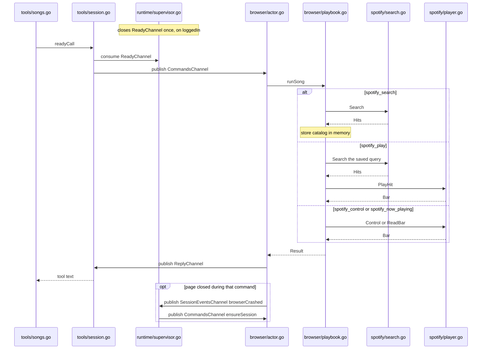
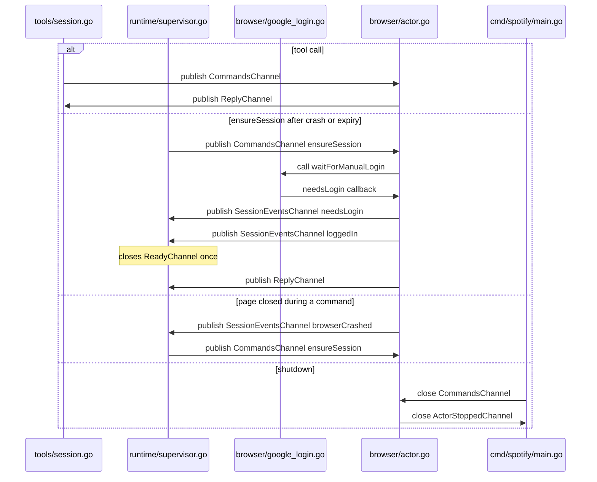

# Phase 5 sequence

A song tool waits until login has closed `ReadyChannel`, then enqueues one command. `browser/actor.go` is the only reader of `CommandsChannel`. `browser/playbook.go` and the Spotify files are direct calls after that read. They do not publish on a channel.

Connecting Cursor starts the process and does not enqueue `ensureSession`. The supervisor publishes that command after `browserCrashed` or `expired`.

## Channels

Four live on the bus. `ReplyChannel` is created once per command.

- `CommandsChannel`
  - Need: one queue, so Playwright does one job at a time.
  - Why: tools and the supervisor both submit work, and only the actor may touch the page.
  - How: buffer of 8. Each value is a `Command`. `main` closes it at shutdown.
  - Publisher: `tools/session.go` for a tool call. `runtime/supervisor.go` for `ensureSession` after `browserCrashed` or `expired`.
  - Subscriber: `browser/actor.go`, the only reader.

- `SessionEventsChannel`
  - Need: the page watcher can report a fact without choosing the next login attempt.
  - Why: the actor sees the page, and the supervisor decides what that means.
  - How: buffer of 4. Each value is a `SessionEvent`: `needsLogin`, `loggedIn`, or `browserCrashed`.
  - Publisher: `browser/actor.go`. Login sends `needsLogin` and `loggedIn`. The command loop sends `browserCrashed`.
  - Subscriber: `runtime/supervisor.go`.

- `ReadyChannel`
  - Need: every song call needs the same signal that login has succeeded.
  - Why: closing an empty channel wakes every waiter at once.
  - How: carries nothing. The supervisor closes it once inside `MarkReady` after `loggedIn`. Nothing is ever sent.
  - Publisher: `runtime/supervisor.go`, by closing it.
  - Subscriber: a song tool, through `readyCall`. No reader waits yet. `spotify_session` does not wait.

- `ActorStoppedChannel`
  - Need: the process must stay up until Chromium is closed.
  - Why: `main` has to know the actor loop has finished.
  - How: carries nothing. Closed once when the actor loop returns, after the browser is closed.
  - Publisher: `browser/actor.go`.
  - Subscriber: `cmd/spotify/main.go`.

- `ReplyChannel`
  - Need: each caller must receive its own result while other callers are also waiting.
  - Why: one shared reply stream would hand a search result to the login waiter.
  - How: `CommandInit` makes one channel per command, buffer 1. The actor sends one `Result`. The channel is not closed. After the receive, nothing keeps it, so the garbage collector frees it.
  - Publisher: `browser/actor.go`, through `cmd.Send`.
  - Subscriber: whoever enqueued that command. `tools/session.go` for a tool call. `runtime/supervisor.go` for `ensureSession`.

## Appendix: keywords

`Browser` in the diagram is the Mermaid name for `browser/actor.go`, because Mermaid treats `Actor` as a keyword.

- `Hit` — one search row, with index, title, artist, and track id.
- `Bar` — the current song on the bottom player bar, including when paused.
- `catalog` — the latest search kept in memory by `playbook.go`.
- `search_id` — the number on a search result that play sends back.
- `result_index` — which row in that search to play.
- `track_id` — the id inside a `/track/...` link.
- `spotify_search` — returns hits and does not start playback.
- `spotify_play` — plays a top hit or a saved hit, then returns the bar.
- `spotify_control` — pause, resume, next, or previous, then returns the bar.
- `spotify_now_playing` — reads the bar and does not click.
- `spotify_session` — returns the phase and a redacted account, without opening Chrome.
- `Search` — opens the tracks page and builds hits.
- `PlayHit` — clicks one search row and waits until that song is the bar.
- `Control` — presses one bar button and returns the bar.
- `ReadBar` — reads the bottom bar.
- `runSong` — chooses search, play, control, or read, and publishes nothing.
- `readyCall` — waits until login is done, then sends one command.
- `ensureSession` — the login command, enqueued after a crash or an expired session.
- `session_not_ready` — login is not finished, so the call does not click the page.
- `nothing_playing` — the bar has no track.
- `stale handle, search again` — this search result is no longer the latest one.
- `now playing mismatch` — the bar is showing a different song than the one requested.
- `needsLogin` — Spotify is open and nobody is signed in.
- `loggedIn` — the session was saved, and the supervisor opens the gate for song tools.
- `browserCrashed` — the page closed, so the supervisor starts login again.
- `challenge` — a Google prompt; nothing sends this yet.
- `expired` — a dead session; nothing sends this yet.
- `TrackRow` — one row in the search results.
- `TrackLink` — the title link in that row.
- `RowPlay` — the play button on that row.
- `ArtistLink` — an artist link.
- `NowPlaying` — the bottom player widget.
- `BarTitle` — the title inside that widget.
- `BarArtist` — the artist inside that widget.
- `PlayPause` — the bar's play/pause button.
- `SkipNext` — the next button.
- `SkipBack` — the previous button.

## Where the channels are used

`Browser` is the Mermaid name for `browser/actor.go`. Each arrow is one channel, with the publisher on the left and the subscriber on the right, except `ReadyChannel`: the supervisor closes it and no file receives it yet.

